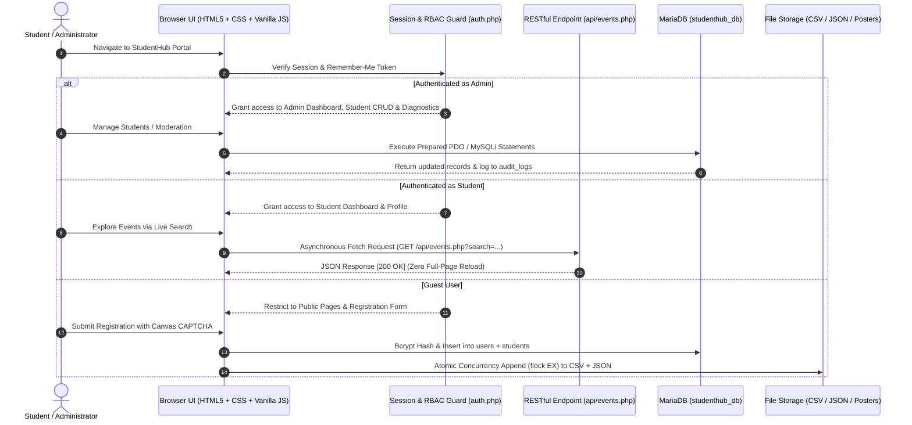

# StudentHub Portal — Academic Lifecycle & Campus Management System


-success?style=flat-square)


---

### Academic Information
* **University:** Charotar University of Science and Technology (CHARUSAT)
* **Institute:** Devang Patel Institute of Advance Technology and Research (DEPSTAR)
* **Department:** Department of Information Technology
* **Course:** Web Development Frameworks (`ITUE203`)
* **Semester:** 3rd Semester, Academic Year 2026–27
* **Developer:** **Dev Patel** ([@Dev-Jay99](https://github.com/Dev-Jay99))
* **Project Repository:** [https://github.com/Dev-Jay99/WDF](https://github.com/Dev-Jay99/WDF)

---

## 📌 Executive Summary

**StudentHub** is a unified, accessible academic management web portal developed from first principles to address student onboarding, records management, campus event discovery, and administrative oversight. 

Constructed systematically across the 15-week curriculum of **ITUE203**, the platform integrates modern client-side standards (Semantic HTML5, CSS Grid/Flexbox design tokens, accessible DOM components, and asynchronous Fetch API) with a secure, hardened PHP 8.2 & MariaDB backend.

---

## 🗺️ Visual System Workflow



---

## 🛠️ Complete Project Technology Stack

This application is engineered strictly using the following cohesive, production-grade technology stack:

| Tier / Layer | Technology | Version / Specification | Exact Role in StudentHub |
| :--- | :--- | :--- | :--- |
| **Relational Database** | **MariaDB** | **10.4.32-MariaDB (InnoDB Engine)** | Normalized Third Normal Form (3NF) relational database, foreign key constraints, `utf8mb4_unicode_ci` character encoding, and Stored Procedure (`sp_get_dashboard_stats`). |
| **Backend Language** | **PHP** | **PHP 8.2.12 (`apache2handler`)** | Core application logic, RESTful API endpoints, server-side validation, anti-CSRF token verification (`hash_equals`), and Bcrypt password hashing (`PASSWORD_BCRYPT`). |
| **Database Abstraction** | **PHP PDO & MySQLi** | **Native Prepared Statements** | Parameterized query execution protecting against SQL injection attacks across all database interactions. |
| **Web Server** | **Apache HTTP Server** | **Apache 2.4.58 (Win64)** | Local HTTP/HTTPS server hosting, Virtual Host (`studenthub.local`), and `.htaccess` upload execution security. |
| **Frontend Markup** | **HTML5** | **Semantic HTML5** | Semantic landmark tags (`<header>`, `<nav>`, `<main>`, `<section>`, `<article>`, `<footer>`), `<a class="skip-link">`, Canvas CAPTCHA, and Canvas analytics charts. |
| **Styling & Layout** | **Vanilla CSS3** | **CSS Grid & Flexbox** | Custom CSS properties (Design Tokens), responsive 12-column Grid, Flexbox, Light & Dark theme tokens, and zero heavy CSS dependencies. |
| **Client-Side Scripting** | **JavaScript (ES6+)** | **Vanilla JS (Fetch API)** | Asynchronous RESTful JSON API consumption (`api/events.php`), 350ms debounced live search, `localStorage` theme persistence, and DOM manipulation. |
| **File Storage** | **PHP Atomic File I/O** | **`flock(LOCK_EX)`** | Thread-safe, concurrency-guarded append-only storage for `registrations.csv`, `registrations.json`, `contacts.csv`, and `contacts.json`. |

---

## 📚 Complete Laboratory Practical Syllabus Mapping (1 – 15)

Every practical in the DEPSTAR ITUE203 laboratory syllabus is implemented with its core problem definition, intermediate extension, and advanced extension:

### [Practical 01] Project Planning, Sitemap & System Specification
* **Objective:** Software requirements engineering and structural sitemap design.
* **Deliverables:** Detailed functional requirements, user personas (Student, Admin, Guest), relational entity modeling, sitemap diagram, and REST route specifications.
* **Key Artifacts:** [`docs/Requirement_Gathering.md`](docs/Requirement_Gathering.md), [`images/`](images/) wireframe diagrams.

### [Practical 02] Semantic HTML5 Page Architecture & Web Accessibility
* **Objective:** WCAG 2.1 AA accessible page structures using native HTML5 landmark elements.
* **Deliverables:** Structured landmarks (`<header>`, `<nav>`, `<main>`, `<section>`, `<article>`, `<aside>`, `<footer>`), `<a class="skip-link">` for keyboard screen-reader navigation, and semantic breadcrumb navigation.
* **Key Artifacts:** [`index.html`](index.html), [`pages/about.html`](pages/about.html), [`docs/Accessibility_Checklist.md`](docs/Accessibility_Checklist.md).

### [Practical 03] Responsive UI Layouts using CSS Grid & Flexbox
* **Objective:** Multi-device layout responsiveness without external CSS bloat.
* **Deliverables:** CSS custom properties (design tokens), 12-column responsive CSS Grid, Flexbox alignment patterns, and modular component loader (`js/components.js`).
* **Key Artifacts:** [`css/style.css`](css/style.css), [`js/components.js`](js/components.js).

### [Practical 04] Client-Side DOM Manipulation & Micro-Interactions
* **Objective:** Vanilla JavaScript DOM manipulation and browser state persistence.
* **Deliverables:** Light/Dark theme toggle persisting in `localStorage`, animated mobile hamburger drawer with backdrop, auto-sliding carousel with hover pause, collapsible FAQ accordion, and modal dialogs.
* **Key Artifacts:** [`js/script.js`](js/script.js), [`pages/courses.html`](pages/courses.html).

### [Practical 05] Comprehensive Form Validation & HTML5 Canvas CAPTCHA
* **Objective:** Real-time client-side input validation and bot mitigation.
* **Deliverables:** 11-field regex validation suite, live password entropy meter, custom HTML5 Canvas CAPTCHA generator with noise and reload capability, and accessible inline error feedback.
* **Key Artifacts:** [`pages/register.html`](pages/register.html), [`docs/Validation_Test_Cases.md`](docs/Validation_Test_Cases.md).

### [Practical 06] Dynamic Asynchronous Data Consumption via Fetch API
* **Objective:** Fetching and transforming external JSON datasets in the browser.
* **Deliverables:** Dynamic consumption of `events.json`, `students.json`, and `faqs.json` (16 records each), debounced keyword search, category filtering, array sorting, client-side pagination, and dependent location dropdowns (Country $\to$ State $\to$ City).
* **Key Artifacts:** [`pages/events.html`](pages/events.html), [`data/events.json`](data/events.json), [`docs/Practical_6_Test_Report.md`](docs/Practical_6_Test_Report.md).

### [Practical 07] Server-Side Input Sanitization & Dual Storage Engine
* **Objective:** Secure server-side processing and concurrent file persistence.
* **Deliverables:** PHP sanitization filters, cryptographic anti-CSRF token verification (`hash_equals`), thread-safe atomic file writing with `flock(LOCK_EX)` writing simultaneously to both CSV and JSON archives, input preservation on validation failure, and an administrative records viewer table.
* **Key Artifacts:** [`pages/process_register.php`](pages/process_register.php), [`pages/view_records.php`](pages/view_records.php), [`data/registrations.csv`](data/registrations.csv), [`data/registrations.json`](data/registrations.json).

### [Practical 08] Relational Database Modeling, PDO & Stored Procedures
* **Objective:** Third Normal Form (3NF) relational database design with prepared queries.
* **Deliverables:** Normalized 6-table schema (`studenthub_db`), dual database driver handler (procedural/OOP MySQLi and PHP PDO), native prepared statements with parameter binding, and Stored Procedure `sp_get_dashboard_stats()`.
* **Key Artifacts:** [`sql/studenthub.sql`](sql/studenthub.sql), [`includes/db.php`](includes/db.php), [`test_connection.php`](test_connection.php).

### [Practical 09] User Registration with Duplicate Guard & Password Hashing
* **Objective:** Secure account creation lifecycle and cryptographic credential storage.
* **Deliverables:** Atomic multi-table insertion into `users` and `students`, unique constraint duplicate check on email/enrollment, irreversible password hashing using `PASSWORD_BCRYPT`, anti-CSRF protection, and automated user registration audit logging.
* **Key Artifacts:** [`pages/register.php`](pages/register.php), [`pages/process_register.php`](pages/process_register.php).

### [Practical 10] Session Security, Idle Timeout & Cryptographic Remember-Me
* **Objective:** Stateful authentication, session hardening, and persistent login.
* **Deliverables:** Session hijacking protection with `session_regenerate_id(true)`, `password_verify()`, 15-minute inactivity session idle timeout, role-based redirection, `last_login` timestamp tracking, and persistent Remember-Me tokens hashed with SHA-256 in the database.
* **Key Artifacts:** [`includes/auth.php`](includes/auth.php), [`pages/login.php`](pages/login.php), [`pages/logout.php`](pages/logout.php).

### [Practical 11] Administrative Student Management CRUD
* **Objective:** Complete record lifecycle management with soft deletion.
* **Deliverables:** Admin portal to Add, View, Edit, and Soft-Delete student records (`status = 'deleted'`), real-time multi-field search, branch/course filtering, and one-click CSV report export.
* **Key Artifacts:** [`pages/students.php`](pages/students.php).

### [Practical 12] Campus Event Management & Validated File Uploads
* **Objective:** Multipart form handling, file validation, and directory security.
* **Deliverables:** Event creation and editing module, file upload validation (strict MIME verification for image/jpeg and image/png, 2 MB size ceiling, unique timestamp renaming), script execution denial in uploads via `.htaccess`, and event activity audit logging.
* **Key Artifacts:** [`pages/events_admin.php`](pages/events_admin.php), [`uploads/posters/.htaccess`](uploads/posters/.htaccess).

### [Practical 13] RESTful JSON API & Single-Page AJAX Event Management
* **Objective:** Asynchronous decoupled backend service consumed without page reloads.
* **Deliverables:** Clean RESTful JSON endpoint (`api/events.php`) supporting `GET`, `POST`, `PUT`, `DELETE` with standard HTTP response codes (`200 OK`, `201 Created`, `400 Bad Request`, `404 Not Found`, `500 Internal Server Error`); consumed via Fetch API in `pages/events_ajax.php` with 350ms debounced live search.
* **Key Artifacts:** [`api/events.php`](api/events.php), [`pages/events_ajax.php`](pages/events_ajax.php).

### [Practical 14] Role-Based Admin Dashboard, Analytics Chart & Audit Trail
* **Objective:** Executive administration interface with live metric aggregations.
* **Deliverables:** Strict RBAC guard (`require_role('admin')`), real-time aggregated KPI counters, user access status toggle (Active / Inactive), pure HTML5 Canvas monthly event registrations bar chart, and an immutable system audit trail table.
* **Key Artifacts:** [`pages/admin_dashboard.php`](pages/admin_dashboard.php).

### [Practical 15] System Diagnostics Center, Master Test Suite & Deployment
* **Objective:** End-to-end integration verification, runtime diagnostics, and production packaging.
* **Deliverables:** System Deployment & Diagnostics Center (`pages/deployment.php`), automated test runner asserting all 15 practicals (`tests/test_all_practicals.php` - 15/15 Passed), `.env.example` environment template, and Apache VirtualHost specification (`docs/apache_vhost.conf`).
* **Key Artifacts:** [`pages/deployment.php`](pages/deployment.php), [`tests/test_all_practicals.php`](tests/test_all_practicals.php), [`.env.example`](.env.example), [`docs/apache_vhost.conf`](docs/apache_vhost.conf).

---

## 🗃️ Database Architecture (`studenthub_db`)

The relational database is designed in **Third Normal Form (3NF)** with foreign key constraints, index optimization, and the `InnoDB` storage engine:

| Table | Primary Key | Description & Relations |
| :--- | :--- | :--- |
| **`users`** | `id` (INT) | Core user authentication identities, Bcrypt password hashes, role (`admin`, `student`, `faculty`), and account status (`active`, `inactive`). |
| **`students`** | `id` (INT) | Normalized student profiles linked to `users.id`, enrollment number (unique), branch course, semester year, contact info, and soft-delete status. |
| **`events`** | `id` (INT) | Campus workshops, hackathons, and technical symposiums with poster image filenames, venue, event date, category, and status (`open`, `closed`). |
| **`registrations`** | `id` (INT) | Transactional event reservations connecting `events.id` and `students.id` with seat status and registration timestamp. |
| **`remember_tokens`** | `id` (INT) | SHA-256 hashed persistent login tokens with explicit expiration dates. |
| **`audit_logs`** | `id` (INT) | Immutable security audit log tracking user ID, action enum, entity type, target entity ID, description, client IP address, and timestamp. |

### Stored Procedure: `sp_get_dashboard_stats()`
Provides atomic KPI aggregations for the admin dashboard:
```sql
CALL sp_get_dashboard_stats();
-- Returns: total_students, total_events, open_events, total_registrations, active_users, total_audit_events
```

---

## ⚡ Automated Master Test Suite (15/15 Passed)

The portal contains an automated verification harness that verifies every syllabus practical module.

### How to Run the Tests:
1. **Via Web Browser:**
   Navigate to: `http://localhost/StudentHub/tests/test_all_practicals.php`
2. **Via Command Line:**
   ```bash
   php tests/test_all_practicals.php
   ```

### Test Verification Summary:
```text
================================================================================
StudentHub Portal - Master Automated Test Runner (Practical 15)
================================================================================
[PASS] P1  : Requirement analysis, README & documentation files exist
[PASS] P2  : Semantic HTML5 core pages present with skip links
[PASS] P3  : Responsive CSS Grid/Flexbox stylesheets & reusable component loader present
[PASS] P4  : JavaScript DOM components: Theme toggle, hamburger menu & slider verified
[PASS] P5  : Registration frontend validation & Canvas CAPTCHA present
[PASS] P6  : External JSON datasets present and readable with valid syntax
[PASS] P7  : Server-side input sanitization, CSRF tokens & dual CSV/JSON storage verified
[PASS] P8  : MySQL schema integrity, PDO connectivity & Stored Procedure (sp_get_dashboard_stats)
[PASS] P9  : Bcrypt password hashing (PASSWORD_BCRYPT) and registration handler operational
[PASS] P10 : PHP session management, 15-min inactivity timeout & SHA-256 Remember-Me tokens
[PASS] P11 : Student Management CRUD module with search, filter, CSV export & soft-delete
[PASS] P12 : Event Management CRUD with poster upload validation & secure upload directory
[PASS] P13 : RESTful JSON API (api/events.php) with HTTP status codes (200, 201, 400, 404, 500)
[PASS] P14 : Role-Based Access Control Admin Dashboard, KPI metrics, status toggle & audit trail
[PASS] P15 : Local Apache Virtual Host config (studenthub.local), .env template & Deployment Guide
--------------------------------------------------------------------------------
Total Assertions: 15 | Passed: 15 | Failed: 0 (100% Success Rate)
================================================================================
```

---

## 🛠️ Local Setup & Deployment Guide

### Prerequisites
* **Web Server:** Apache 2.4.58 (packaged via XAMPP)
* **Backend Runtime:** PHP 8.2.12 (with extensions: `pdo`, `pdo_mysql`, `mysqli`, `json`, `session`, `mbstring`, `fileinfo`, `exif`, `curl`)
* **Relational Database:** MariaDB 10.4.32 (packaged via XAMPP)

### Step-by-Step Installation

1. **Clone the Repository into XAMPP `htdocs`**:
   ```bash
   cd "D:/DEPSTAR SEM3/WDF/PHP/htdocs"
   git clone https://github.com/Dev-Jay99/WDF.git StudentHub
   ```

2. **Start Apache & MariaDB in XAMPP**:
   * Open the **XAMPP Control Panel**.
   * Start both the **Apache** and **MySQL / MariaDB** services.

3. **Import Database Schema & Sample Records**:
   * Open phpMyAdmin: `http://localhost/phpmyadmin/`
   * Create a database named `studenthub_db`.
   * Go to **Import** $\to$ Choose [`sql/studenthub.sql`](sql/studenthub.sql) $\to$ Click **Go**.

4. **Initialize Environment Variables**:
   ```bash
   copy .env.example .env
   ```
   *Default database settings in `includes/db.php` connect directly out-of-the-box (`127.0.0.1:3306`, user `root`, password empty).*

5. **Access the Application**:
   * **Home Portal:** `http://localhost/StudentHub/`
   * **Database Diagnostics:** `http://localhost/StudentHub/test_connection.php`
   * **System Deployment Center:** `http://localhost/StudentHub/pages/deployment.php`
   * **Master Test Suite:** `http://localhost/StudentHub/tests/test_all_practicals.php`

---

## 🔑 Default Evaluation Accounts

| Role | Email Address | Password | Capabilities |
| :--- | :--- | :--- | :--- |
| **Administrator** | `admin@charusat.edu.in` | `Admin@123` | Full administrative control, student CRUD, event CRUD, status moderation, system diagnostics, and audit trail. |
| **Student** | `student@charusat.edu.in` | `Student@123` | Student dashboard, profile editor, event exploration, and live registration. |

---

## 📂 Project Directory Structure

```text
StudentHub/
├── index.html                  # Semantic Home Page (Practical 2)
├── index.php                   # Full-Stack Dynamic Home Page with RBAC Navbar (Practical 15)
├── db.php                      # Root Database Connection Forwarder
├── .env.example                # Production Environment Configuration Template (Practical 15)
├── .gitignore                  # Git VCS Ignore Rules for OS, IDE & Credentials
├── test_connection.php         # Diagnostic Script for MySQLi, PDO & Stored Procedures (Practical 8)
├── sql/                        # Relational Database Schema & Data Dumps
│   └── studenthub.sql          # 6 normalized tables, stored procedures & seed data
├── api/                        # RESTful JSON API Endpoints (Practical 13)
│   └── events.php              # Asynchronous JSON API supporting GET, POST, PUT, DELETE
├── includes/                   # Core Server-Side Business Logic & Helpers
│   ├── auth.php                # Sessions, timeout, password_verify, RBAC & Remember-Me tokens (Practical 10)
│   ├── db.php                  # Central MySQLi & PDO prepared database handler (Practical 8)
│   ├── csrf.php                # Anti-CSRF token generator & timing-safe validator (Practical 7 & 9)
│   └── form_helpers.php        # Input sanitization & safe atomic file locking flock() (Practical 7)
├── pages/                      # Portal Subpages & Administrative Modules
│   ├── admin.html              # Static Admin landmark skeleton (Practical 2)
│   ├── admin_dashboard.php     # RBAC Admin Dashboard with KPI stats, user toggle & analytics chart (Practical 14)
│   ├── deployment.php          # System Deployment & Master Diagnostics Center (Practical 15)
│   ├── students.php            # Student Management CRUD with search, filter, CSV export & soft delete (Practical 11)
│   ├── events_admin.php        # Event Management CRUD with poster upload & validation (Practical 12)
│   ├── events_ajax.php         # Single-page AJAX event CRUD with debounced search & Fetch API (Practical 13)
│   ├── login.php               # Secure login with sessions, timeout alert & Remember-Me (Practical 10)
│   ├── process_login.php       # Password verification, session regeneration & RBAC redirect (Practical 10)
│   ├── logout.php              # Session destruction & remember token invalidation (Practical 10)
│   ├── register.php            # Registration form with MySQLi prepared insert & audit log (Practical 9)
│   ├── process_register.php    # Server-side validation, Bcrypt hashing & duplicate check (Practical 9)
│   ├── dashboard.php           # Authenticated role-protected student dashboard (Practical 10)
│   ├── view_records.php        # Stored CSV/JSON records viewer (Practical 7)
│   ├── events.html             # Dynamic campus events directory with live Fetch API (Practical 6)
│   ├── courses.html            # Course curriculum with syllabus popup modals (Practical 4)
│   ├── attendance.html         # Subject-wise attendance tracker
│   ├── assignment.html         # Assessment deadlines & submission status
│   ├── result.html             # Academic SGPA/CGPA grade sheets
│   ├── profile.html            # Student profile with academic credentials
│   ├── profile.php             # Authenticated student profile editor with audit logging
│   ├── faq.html                # Searchable FAQ directory with accordion UI (Practical 6)
│   ├── feedback.html           # Interactive student feedback form
│   ├── contact.html            # Static contact page
│   ├── contact.php             # Dynamic contact form with server-side validation
│   └── process_contact.php     # Contact form submission handler
├── tests/                      # Automated Verification & Test Suites (Practical 15)
│   └── test_all_practicals.php # Master automated test runner covering all 15 practical assertions
├── uploads/                    # User-Uploaded Media Assets
│   └── posters/                # Event poster uploads protected by .htaccess execution denial (Practical 12)
├── data/                       # External JSON & CSV Datasets (>= 15 records each)
│   ├── events.json             # 16 campus events, hackathons & workshops
│   ├── students.json           # 16 verified student profile records
│   ├── faqs.json               # 16 academic & portal FAQ entries
│   ├── registrations.csv       # Practical 7 CSV file archive
│   ├── registrations.json      # Practical 7 JSON file archive
│   ├── contacts.csv            # Contact inquiry CSV archive
│   └── contacts.json           # Contact inquiry JSON archive
├── css/                        # Global & Modular Stylesheets
│   ├── style.css               # Global theme tokens, navbar, grid, accessibility & utilities
│   ├── index.css               # Home page specific hero and layout styles
│   └── *.css                   # Page-specific modular stylesheets
├── js/                         # Client-Side Scripts
│   ├── script.js               # Theme toggle, slider, accordion, modal, validation & Fetch API
│   └── components.js           # Practical 3 Advanced jQuery reusable layout component loader
├── images/                     # Branding, Assets & Mockups
│   ├── logo.png                # StudentHub portal logo
│   └── *.png                   # System sitemap & wireframes
└── docs/                       # Project Documentation & Specifications
    ├── apache_vhost.conf       # Apache Virtual Host configuration for studenthub.local (Practical 15)
    ├── Deployment_Guide.md     # Step-by-step local & cloud deployment instructions (Practical 15)
    ├── Requirement_Gathering.md# Functional requirements, user roles, ER model & REST route plan (Practical 1)
    ├── Accessibility_Checklist.md# WCAG 2.1 AA accessibility verification checklist (Practical 2)
    ├── Validation_Test_Cases.md# Registration form test cases matrix (Practical 5)
    ├── Practical_6_Test_Report.md# Fetch API, array methods & filter test report (Practical 6)
    └── Practical_7_Test_Report.md# PHP server-side validation & file storage report (Practical 7)
```

---

## 📜 Academic Integrity & License

This project is authored by **Dev Patel** for the **ITUE203 (Web Development Frameworks)** course under the curriculum of **Devang Patel Institute of Advance Technology and Research (DEPSTAR)**, **Charotar University of Science and Technology (CHARUSAT)**.

Distributed under the [MIT License](LICENSE) for educational, research, and non-commercial development.
