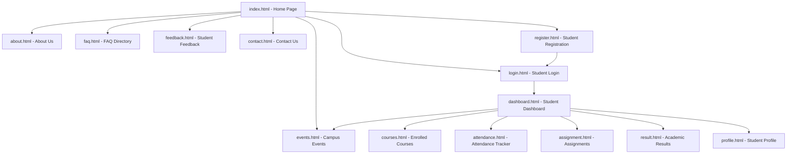
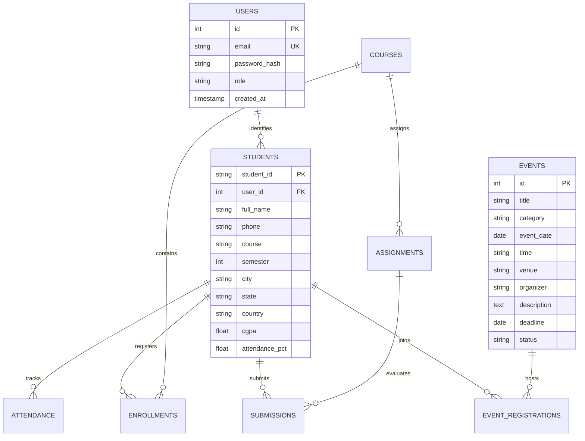

# StudentHub Portal - Functional Requirements & System Architecture

**Subject:** Web Development Frameworks (ITUE203)  
**Institution:** Devang Patel Institute of Advance Technology and Research (DEPSTAR)  
**University:** Charotar University of Science and Technology (CHARUSAT)  
**Semester:** 3rd Semester, B.Tech Computer Engineering  

---

## 1. Project Overview & Scope

The **StudentHub Portal** is a centralized, accessible, responsive student information management system designed for engineering students and academic faculty. It unifies essential student lifecycle tasks into an intuitive web interface, including:
- Academic tracking (courses, credits, faculty details)
- Real-time attendance monitoring with eligibility status
- Course assignment deadlines and lab submission tracking
- Semester SGPA/CGPA result computation and transcript access
- Campus event exploration with category filtering, search, and registration deadlines
- User-friendly registration with regular expression validation and Canvas CAPTCHA
- Accessible design with WCAG 2.1 AA standards, keyboard navigation, and dark/light mode

---

## 2. User Roles & Permissions

| Role | Permissions & Capabilities |
| :--- | :--- |
| **Guest / Public** | • Browse Home, About, Events directory, FAQ, and Contact pages • Access student registration and login forms • Submit general inquiries and feedback |
| **Student** | • Secure login & session management • View personalized Dashboard with CGPA, attendance %, and due assignments • Access enrolled course syllabi via interactive modals • Track subject-wise lecture & lab attendance • View semester results and SGPA breakdown • Register for campus hackathons and workshops • Update profile details with dependent location selection |
| **Faculty / Admin** (Future Modules) | • View student directory and performance statistics • Manage event listings, update venues and deadlines • Update course assignments and upload lecture materials • Review student feedback and system audit logs |

---

## 3. Site Navigation & Page Hierarchy

---

## 4. Entity-Relationship (ER) Model (Practical 1 & 8 Design)

---

## 5. REST Route Plan for Future Backend Integration (Practical 1 Extension)

| Method | Endpoint | Description | Role Required |
| :--- | :--- | :--- | :--- |
| `POST` | `/api/auth/register` | Register new student with hashed password | Public |
| `POST` | `/api/auth/login` | Authenticate student, create PHP session | Public |
| `POST` | `/api/auth/logout` | Destroy session & invalidate tokens | Authenticated |
| `GET` | `/api/events` | List all campus events (with search & filter) | Public |
| `GET` | `/api/events/{id}` | Get event details | Public |
| `POST` | `/api/events` | Create new event with poster upload | Admin |
| `GET` | `/api/students` | Get student directory with pagination | Admin / Student |
| `GET` | `/api/students/{id}` | Get specific student profile & stats | Student / Admin |
| `PUT` | `/api/students/{id}` | Update student contact & location details | Student / Admin |
| `GET` | `/api/courses` | List enrolled semester courses & syllabi | Student |
| `GET` | `/api/attendance/{id}`| Fetch subject-wise attendance breakdown | Student |
| `POST` | `/api/feedback` | Submit student rating & feedback comments | Public / Student |
